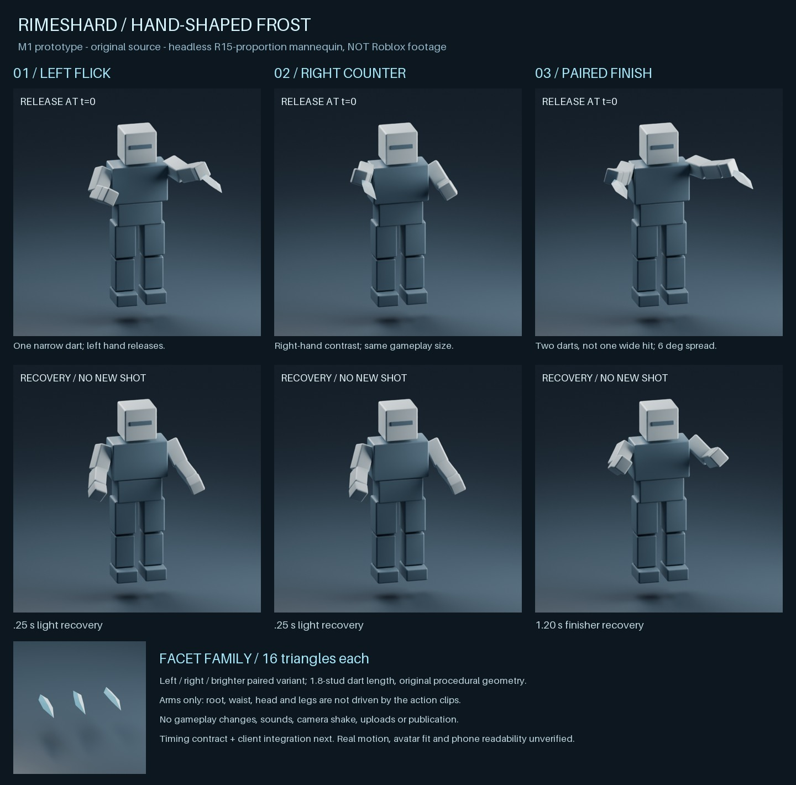

# T-043d1 — original M1 shard and R15 pose prototype

S67 · 2026-10-31 · option A approved; **prototype only, not live quality approval**.



[Offline motion preview](T-043d1-previews/m1-motion.gif) — 10 fps sampled pose curves on a proportioned mannequin, not Roblox playback, hit timing, locomotion blending or performance evidence.

## Delivered
- Three original faceted darts: left/right asymmetric ridge and paired variant, each 10 vertices / 16 triangles, closed positive-volume mesh, 1.8 studs long. One visual mesh per projectile; no special-move art.
- R15 left flick, right counter-flick, paired release: 4/4/5 keyframes, Action priority, non-looping, upper arms/forearms/hands only. Root/LowerTorso/UpperTorso containers have zero weight; no head, leg, foot, waist or root motion. Terminal arms are identity/zero weight.
- Both lights last 0.25 s, finisher 1.2 s; first release is t=0. A brief arm overshoot and gathering recovery carry the rhythm without a new wind-up. Pair has two separate darts, not a wider single projectile.
- Sources: [`rime_m1.py`](../../art/blender/rime_m1.py), [`rime_m1.json`](../../art/poses/rime_m1.json), [`rime_m1_sequences.luau`](../../scripts/rime_m1_sequences.luau). Rebuildable FBX/GLB, editable Blender scenes and Roblox KeyframeSequence `.rbxm` outputs live in ignored `build/art/rime_m1/`.
- No `src/` gameplay changes, no asset upload, no cloud test or publication. Damage, hitboxes, 120 speed, 45 range, 6° pair spread and 0.8 s chain window remain untouched.

## Reproduce
```sh
bash scripts/blender-setup.sh
~/.local/bin/blender -b --factory-startup --python-exit-code 1 -P art/blender/rime_m1.py -- build/art/rime_m1 --motion
~/.local/bin/blender -b --factory-startup --python-exit-code 1 -P scripts/verify_rime_m1_meshes.py
lune run scripts/export_rime_m1.luau
uv run scripts/rime_m1_board.py
bash scripts/check.sh
```
The JSON is the editable pose authority. Blender uses the same Euler curves (Roblox XYZ, Rx*Ry*Rz) on an approximate joint layout, NOT an imported R15 rig; inspect actual Motor6D axes/attachment frames and body scales in T-043d2. Blender +Y forward converts to Roblox -Z with Y-up export; origin is the dart centre. Inspect importer scale/forward readback before linking any MeshId. The scene mannequin is a preview prop, not a shipped character asset.

## Provenance, ownership and permission route
All geometry, colours and pose curves here were authored procedurally for Robby in S67. No reference footage, extracted game mesh, third-party texture, animation or sound is incorporated. Existing [T-043a visual evidence](T-043a-reference-audit.md) informs contrast/negative space, not copied forms. Fresh search surfaced [combat readability analysis](https://www.jasondeheras.com/gamedesign/2021/4/23/how-do-3rd-person-melee-combat-games-communicate-game-and-hit-feel); borrow pose contrast/follow-through, **not** an additional M1 wind-up. Search snippets about Rell Seas were not independently verified and are not an implementation requirement.

No Roblox asset IDs exist for this kit yet. Use the existing `roblox-open-cloud` integration route in [OPEN_CLOUD](../../.ai/OPEN_CLOUD.md); experience owner is users/7738981129, universe 10773761715. For animation upload, adapt `scripts/upload_anims.py` metadata to say **original Rimeshard M1**, not its existing movement-kit description, then upload generated `.rbxm` under that creator. For mesh import, use the owner-controlled FBX/GLB asset workflow supported at integration time; verify supported upload type rather than assume the Animation endpoint accepts a mesh. Grant restricted assets to this experience, await moderation, read back creator/type/permissions and test loading before assigning IDs. If ownership changes, explicitly migrate/grant access. Record resulting IDs/provenance in the repo. No credentials in files or chat; no publication implied by asset upload.

## Integration constraints (T-043d2 after T-043c1)
- Load through the existing Humanoid Animator; Action clips must blend only owned arm joints. Walking/running still own pelvis, legs and head. Stop/fade only this system's tracks on slot switch, rejection, death and replacement; never stop all tracks.
- The t=0 `Release` marker documents intent; do **not** rely on a listener firing at exactly zero. Immediate accepted/predicted cast presentation must be explicit/idempotent. Markers never authorize damage. Timing/prediction reconciliation remains T-043c1/d2.
- Rendered hand-adjacent darts are staged silhouette examples, **not** new server launch origins. Bridge hands to the existing server spawn origin without moving hitboxes; advance actual projectile visuals on the accepted trajectory. Pair placement in this board does not claim world-space launch accuracy.
- Preview materials are opaque facet colours, not final Glass/shader/transparency tuning. Assign supported Roblox colours/materials deliberately; do not depend on FBX carrying Blender material appearance.
- Blend/fade choice and extreme avatar proportions can alter silhouettes; test actual R15 Motor6Ds, standing, moving, slot/death/rejection cleanup, aim and phone readability before calling it integrated. No root movement lock or locomotion pause. Pair settle must not imply an extra hit.

## Evidence and open validation
- Mesh generator gates: each dart is manifold, positive volume, 16 triangles, <2-stud length. `verify_rime_m1_meshes.py` re-imported all six FBX/GLB files: 1.8-stud length and +Y tip restored, PASS (Blender round-trip only).
- Three new offline Lune tests (`tests/rime_m1_assets.luau`, separate check.sh stage; excluded from the cloud gameplay spec glob) gate original clip counts/recovery against Config, round-trip arm-only hierarchy/weights/zero translations, distinct left/right/pair releases and one t=0 marker; export `.rbxm` round-trip PASS.
- `check.sh` PASS; 278/278 gameplay tests (54 specs), 3 offline M1 authoring tests and five mocked client-input cases PASS; gameplay source unchanged. Board visually inspected after correcting camera/forward axes: front-visible left/right actions and paired finisher are distinct. Six static renders plus offline curve GIF are reproducible.
- Still unverified: actual Roblox track interpolation and animation import axes, walking/running blending, accepted-cast alignment, low-graphics/mobile readability, audio and device FPS. Prototype acceptance does not satisfy the owner's M1 quality gate (T-043e), and specials remain gated.
